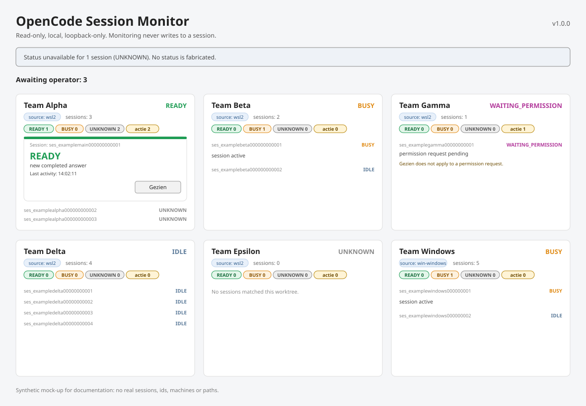

# OpenCode Session Monitor

A read-only, local dashboard that shows what every OpenCode session in your
project worktrees is doing right now: waiting for a permission prompt, busy,
finished with a new answer, idle, or in an error/unknown state.



## Why

When several OpenCode agents run in parallel across different worktrees, the
one that needs you is usually buried in a terminal window you are not looking
at. This monitor polls the local OpenCode API through the OpenCode CLI, groups
sessions by worktree ("team"), and renders a single page you can leave open on
a second screen. It never sends a prompt, never answers a permission request
and never writes to a session.

## Features

- **Read-only by construction.** Only a fixed allowlist of GET operations is
  issued, always through `opencode api ...` with a structurally frozen argv.
  There is no code path that can prompt, abort or mutate a session.
- **Multi-source.** One entry per OpenCode installation, for example one per
  WSL2 distribution, plus optionally the native Windows CLI invoked through
  WSL2 interop. Sources poll independently: a broken source only marks its own
  cards UNKNOWN.
- **Discovery by exact worktree match.** Leave `session_id` empty and every
  primary session whose reported worktree matches the configured directory
  becomes a card. Several primaries in one worktree are stacked.
- **Clear states.** `WAITING_PERMISSION`, `READY`, `BUSY`, `IDLE`, `ERROR` and
  `UNKNOWN`, with per-session reason, last activity and a redacted summary of
  the newest answer.
- **Gezien.** A local "seen" acknowledgement on READY cards that clears the
  highlight without touching OpenCode.
- **JSON view.** `GET /status.json` exposes the same snapshot for scripts.
- **Optional metrics.** `--metrics-jsonl PATH` appends one bounded line per
  completed poll cycle per source. Off by default.
- **Boring dependencies.** Python 3.10+ standard library only, no packages to
  install, no build step.

## Requirements

- Python 3.10 or newer on the machine that runs the monitor.
- The OpenCode CLI, installed and authenticated for the user running the
  monitor, with the `opencode api` subcommand available.
- Linux, or WSL2 on Windows. Windows interop (a second source that calls the
  native `opencode.exe`) is optional and easy to remove from the example config.

## Install

```sh
git clone https://github.com/jeremysiebers/opencode-session-monitor.git opencode-session-monitor
cd opencode-session-monitor
cp config/teams.example.json config/teams.json
$EDITOR config/teams.json        # set opencode_bin and your worktree paths
./ocmon
```

Then open <http://127.0.0.1:8765/>.

`config/teams.json` and the `.runtime/` state directory are deliberately
git-ignored: configuration is per machine, not part of the project.

## Quickstart

1. Find the CLI: `command -v opencode` (for example
   `/home/you/.local/bin/opencode`). Put that absolute path in `opencode_bin`.
2. List the worktree directories you want to watch. Use exactly the directory
   OpenCode reports for a session (`session.list` / `session.get`
   `location.directory`), not a symlinked or relative variant.
3. Copy the example config, edit the five Linux team entries (delete or edit
   them as you like), and run `./ocmon`. The example also contains an optional
   Windows source; delete that `sources[]` object if you do not run OpenCode
   natively on Windows. With the unedited placeholders
   (`/home/you/.local/bin/opencode` and
   `/mnt/c/REPLACE_WITH_PATH_TO/opencode.exe`) the monitor starts but discovers
   no sessions, so every team shows UNKNOWN until the paths and binary are
   edited.
4. Open the dashboard. The first poll builds a baseline: a session that already
   had an answer before the monitor started is IDLE until the next new answer.

## Statuses

| Status | Meaning | What to do |
| --- | --- | --- |
| `WAITING_PERMISSION` | The session has a pending permission request. | Answer it in the OpenCode session; Gezien does not apply. |
| `READY` | A new completed assistant answer arrived since you last acknowledged it. | Read it, then press **Gezien** to clear the highlight locally. |
| `BUSY` | The session (or one of its child sessions) is active. | Wait. |
| `IDLE` | Nothing new since the last acknowledged answer. | Nothing. |
| `ERROR` | The last turn failed or was interrupted, and the session is not currently active. | Inspect the session. |
| `UNKNOWN` | No reliable status: missing or unrecognized outcome, archived session, stale feed, incomplete discovery or a CLI failure. | Check the banner and the session. |

**Gezien** ("seen") is a purely local acknowledgement. It removes the card's
READY highlight and lowers the awaiting count; it never contacts OpenCode and
cannot clear `WAITING_PERMISSION`.

A card whose last successful update is older than
`stale_threshold_seconds` (default 15 s) is displayed as `UNKNOWN`; the monitor
never repeats a stale status as if it were current.

## Tests

The suite is fully offline: recording fake CLIs stand in for OpenCode, no
network, no service and no real binary is needed.

```sh
python3 -m unittest discover -s tests -v
```

218 tests, expected `OK`.

## Versioning (SemVer)

The project follows [Semantic Versioning](https://semver.org/):
`MAJOR.MINOR.PATCH`, with breaking changes only in a major release. The
version has a single source, `monitor/version.py`. It is reported by
`./ocmon --version` (`OpenCode Session Monitor 1.0.0`), shown next to the
title in the dashboard header and exposed as the top-level `version` key of
`/status.json`. Release notes live in [CHANGELOG.md](CHANGELOG.md).

## Security summary

The monitor talks to OpenCode only through `opencode api` GET operations, binds
to loopback by default, holds no credentials and writes only its own state file.
A non-loopback bind is refused unless you explicitly pass
`--allow-external-bind`, and there is no authentication because there is no
remote surface by design. See [SECURITY.md](SECURITY.md) for the threat model.

## Limitations

- Single-user, single-machine tool. No authentication, no TLS, no multi-tenant
  story; the loopback bind is the security boundary.
- The dashboard is a best-effort view of what the CLI reports. It is not an
  audit log and it never fabricates a status.
- Worktrees are matched by a lexical comparison of the configured path and the
  reported path; symlink resolution is intentionally not performed.
- Windows interop is optional, uses your Windows CLI and its credentials, and
  needs WSL2 interop to be available.
- At most 32 primary sessions per team and 8 parallel session fetches are
  handled per poll (code constants); beyond 32 the team fails closed to
  `UNKNOWN`.
- No long-term history or graphs; optional per-cycle JSONL metrics are the only
  time series.

## License

MIT. See [LICENSE](LICENSE).
